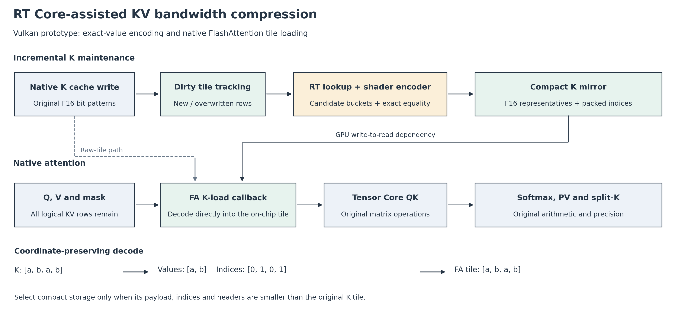

# RT Core-assisted KV bandwidth compression

This Vulkan prototype stores repeated K values as native 16-bit representatives and packed coordinate indices. FlashAttention restores each value while loading its matrix tile. All K rows, masks and V contributions enter the native attention calculation.

The objective is to reduce K bytes read during decoding. QK, softmax, PV and split-K use the native FlashAttention implementation.

## Data path



[SVG](figures/kv-compression.svg) | [PDF](figures/kv-compression.pdf)

Each K head is divided into tiles of at most 4,096 values. For a 256-dimensional head, a tile contains 16 rows. The encoder compares the stored bit patterns, including distinct positive and negative zero. It writes one representative per distinct value and an index for every original coordinate. It uses the original K representation when the encoded tile would occupy at least as many bytes.

RT queries locate candidate buckets. Each nonempty bucket issues one query, with at most 256 queries per changed tile. The compute shader verifies exact equality and writes the dictionary and indices. Bucket geometry is built once. Encoding runs in the native GPU command stream; GPU dependencies publish the encoded values before FlashAttention reads them.

SET_ROWS writes mark affected tiles for refresh. Uploads and other cache changes invalidate the derived representation. A decoder restores the original K bits in the cooperative-matrix load callback, without writing a full expanded K tensor to device memory.

Each native QK block checks the encoding headers for its K tiles. Blocks containing only raw tiles use the native matrix loader directly; mixed or compressed blocks use the indexed load callback. Clean tiles only check their update generation in the encoder dispatch.

The prototype keeps the dense K cache as its source and raw-tile path. It therefore adds a derived cache allocation. Its initial measurement target is read traffic; physical KV allocation reduction requires a compressed cache storage layout.

## Configuration

Build the Vulkan backend with cooperative-matrix-2 support and run on a device with ray-query and acceleration-structure support:

```sh
GGML_VK_RT_KV_COMPRESS=1 ./build/bin/llama-cli -m model.gguf -dev Vulkan0 -ngl 99 -fa on -ctk f16 -ctv f16
```

The initial path uses single-token decoding with native F16 K and cooperative-matrix-2 FlashAttention. Other configurations retain native K loading.

## Validation

Run the native operator tests with compression disabled and enabled:

```sh
GGML_VK_RT_KV_COMPRESS=0 ./build/bin/test-backend-ops -b Vulkan0 -o kv_compress
GGML_VK_RT_KV_COMPRESS=1 ./build/bin/test-backend-ops -b Vulkan0 -o kv_compress
```

The cases exercise low-cardinality and constant K tiles, finite half-precision extremes, signed zero, subnormals, GQA, multiple K heads, partial tiles, split-K, masks, raw-tile fallback and I32/I64 SET_ROWS overwrites. Update cases compare attention before and after writes to historical and tail rows.

Set `GGML_VK_RT_KV_COMPRESS_STATS=1` to report compressed tiles at backend cleanup. The report includes the first compressed row, so unused context capacity can be separated from populated model K. Paired logit captures use the same model, input tokens, cache types and native FlashAttention settings.

On an RTX 5060 Ti, the nine operator cases passed with compression both disabled and enabled. Compressed-tile use was confirmed on the constructed low-cardinality and overwrite cases.

QwenPaw-flash-9B-20260330-q4 was checked with an 8192-token prompt and 16 teacher-forced decode steps, F16 K/V, native FlashAttention and an 8448-token context. All 3,973,120 decode logits matched: RMSE 0, maximum absolute difference 0 and top-1 agreement 16/16.

At the end of that run, each attention layer had 60 compressed tiles, starting at row 8208. The populated rows were 0 through 8207, so all populated K tiles used their raw representation. This format saved no populated K payload in that model run. The short validation run produced 31.63 tokens/s with native loading and 23.99 tokens/s with the codec enabled, including its initial encoding.

## Bandwidth accounting

For N native 16-bit values and U representatives, let b = ceil(log2(U)), with b = 0 for U = 1. The encoded payload in bytes is:

```text
8 + 4 * ceil(U / 2) + 4 * ceil(N * b / 32)
```

The header uses 8 bytes. Representatives and indices are aligned to 32-bit words. A tile is encoded only when this total is smaller than 2N. A constructed tile with N = 4096 and U = 16 uses 2088 payload bytes instead of 8192, a 74.51% reduction in logical K payload.

Measure dictionary and index reads, raw-tile reads, incremental encoding traffic and end-to-end decode time. Logical payload size and measured GPU DRAM traffic describe different costs. The RT lookup should also be compared with direct bucket lookup to establish its contribution to encoding cost.

## Discussion scope

The earlier [KV filtering PR](https://github.com/ggml-org/llama.cpp/pull/32558) removed selected attention contributions. This branch explores exact-value storage and native attention loading. Filtering throughput and row-skipping measurements do not measure this codec.

The first review targets are the packed format, the native load callback and cache update tracking. The next steps are:

1. Measure distinct-value counts in populated K tiles across models and context lengths.
2. Compare total read and encoding traffic, and RT lookup against direct GPU bucket lookup.
3. Use a GPU dirty queue and indirect dispatch if metadata probes across clean tiles are significant.
4. Evaluate encoding overlap and a storage layout that replaces the dense K allocation.
